# Stylesheets for `RenderHTML`

Drop-in CSS for the `<article class="recipemd-recipe">` produced by
[`Recipe.RenderHTML`](../../render_html.go). They only target the
`recipemd-*` classes and the markdown inside the instructions, so they
coexist with the rest of a page.

They are ordered from simplest to most complete:

| File | Lines | Highlights |
|---|---|---|
| [`01-minimal.css`](01-minimal.css) | ~20 | Readable measure, system font, bold amounts. |
| [`02-clean.css`](02-clean.css) | ~60 | Typographic hierarchy, bulletless lists, muted metadata, follows OS light/dark through `color-scheme`. |
| [`03-cookbook.css`](03-cookbook.css) | ~115 | Printed-cookbook look: serif, paper tones, small caps, ornament separators, aligned amount column. |
| [`04-modern.css`](04-modern.css) | ~170 | Cards, two-column layout on wide screens, step badges, automatic dark mode. |
| [`05-complete.css`](05-complete.css) | ~430 | Design tokens, light/dark with manual override, fluid type, sticky ingredient panel, container queries, touch-sized rows, print / reduced-motion / high-contrast support. |

## Usage

```html
<link rel="stylesheet" href="05-complete.css">
...
<!-- output of r.RenderHTML(3) -->
<article class="recipemd-recipe">…</article>
```

Always include `<meta name="viewport" content="width=device-width, initial-scale=1">`
so the responsive rules work on phones.

### Light / dark switching (`05-complete.css`)

By default the theme follows the operating system. To let readers choose,
set `data-theme="light"` or `data-theme="dark"` on `<html>`; remove the
attribute to go back to the system setting. A minimal toggle:

```html
<button class="theme-toggle" type="button">◐ Theme</button>
<script>
  (function () {
    var root = document.documentElement, key = "recipemd-theme";
    var saved = localStorage.getItem(key);
    if (saved) root.dataset.theme = saved;
    document.querySelector(".theme-toggle").addEventListener("click", function () {
      // system -> light -> dark -> system
      var next = { "": "light", light: "dark", dark: "" }[root.dataset.theme || ""];
      if (next) { root.dataset.theme = next; localStorage.setItem(key, next); }
      else { delete root.dataset.theme; localStorage.removeItem(key); }
    });
  })();
</script>
```

To re-theme, override the `--rmd-*` custom properties on `:root`
(and inside `:root[data-theme="dark"]` for the dark palette).

`04-modern.css` and `05-complete.css` also paint the page background
(`:root:has(.recipemd-recipe)`) so the area around the recipe matches.
Delete that rule if your site manages its own background.

### Notes on the markup

- Tags are rendered as one `<em>` with comma-separated values, so they
  appear as a single chip rather than one per tag.
- The "Ingredients" and "Method" headings in 04/05 are generated with
  `::before`, because the renderer does not emit headings for those
  sections.

## Previews

[`sample.md`](sample.md) rendered with each stylesheet. Regenerate with
`./build.sh` (HTML in `preview/`) and `node screenshot.js` (needs
Playwright).

### 01 — Minimal

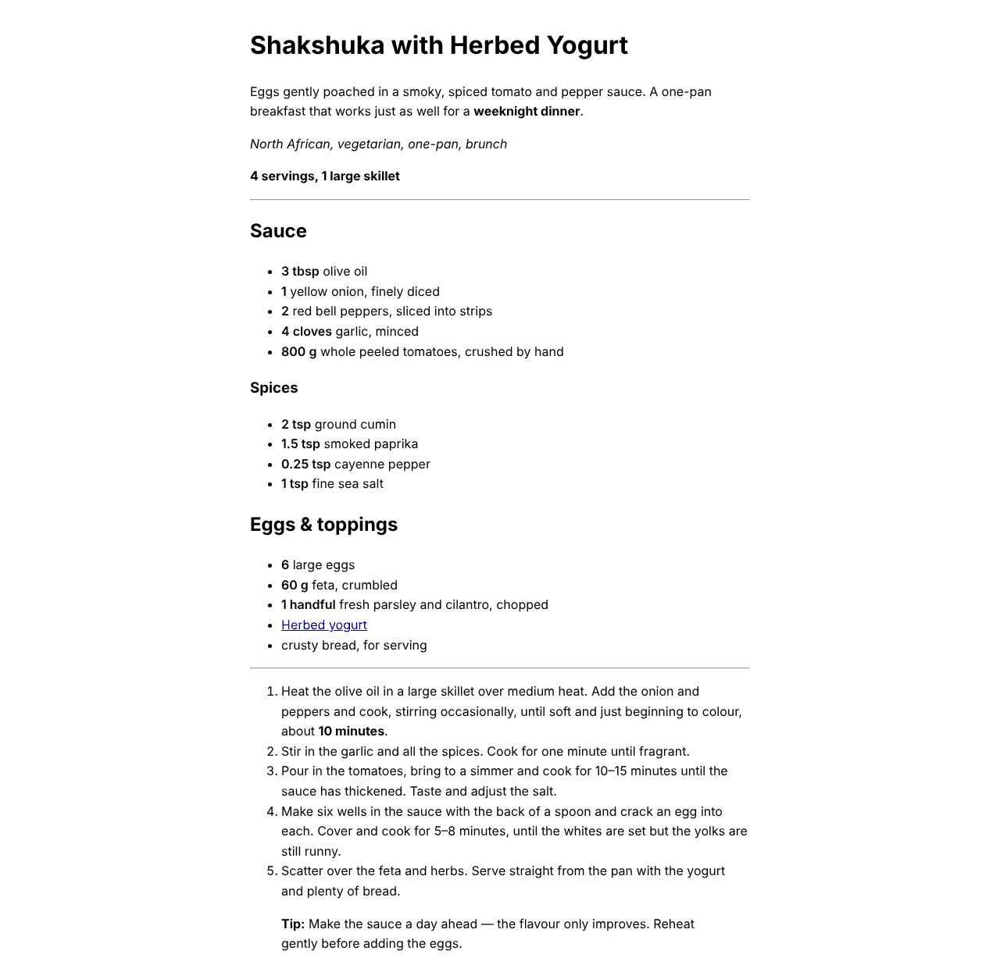 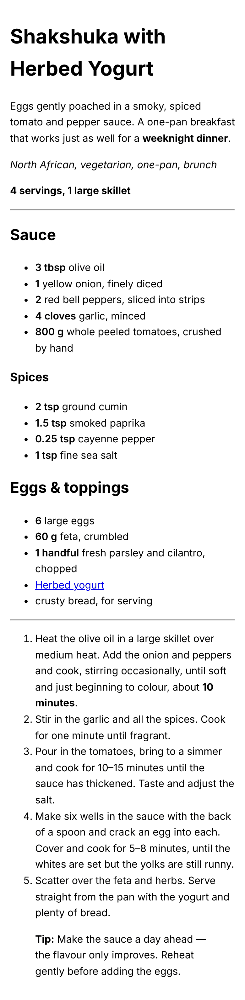

### 02 — Clean

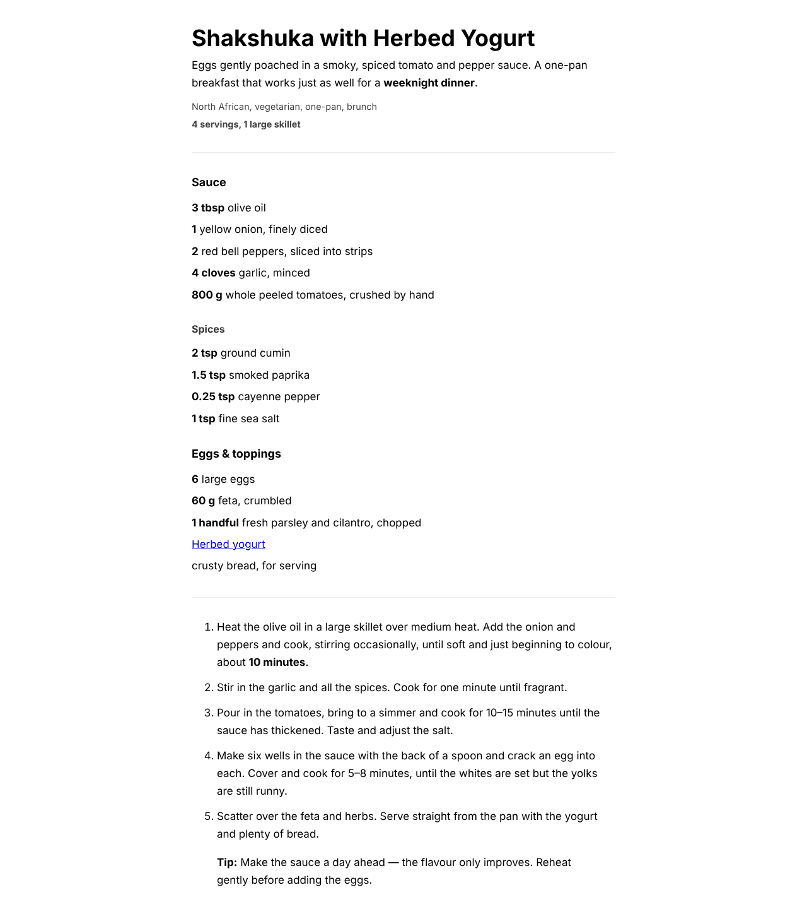 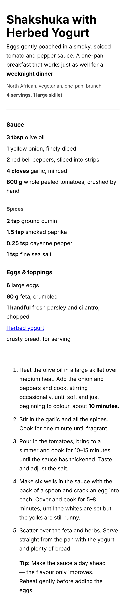

### 03 — Cookbook

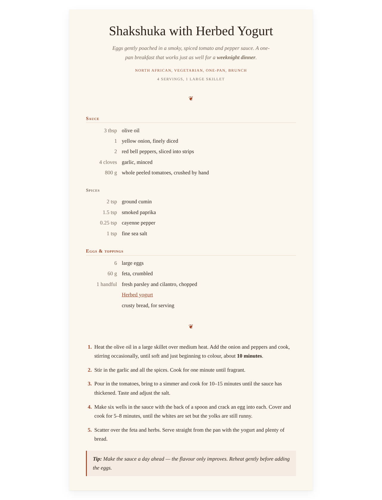 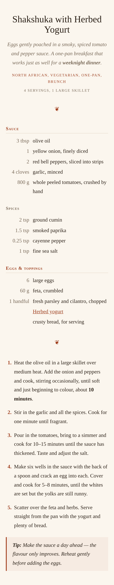

### 04 — Modern

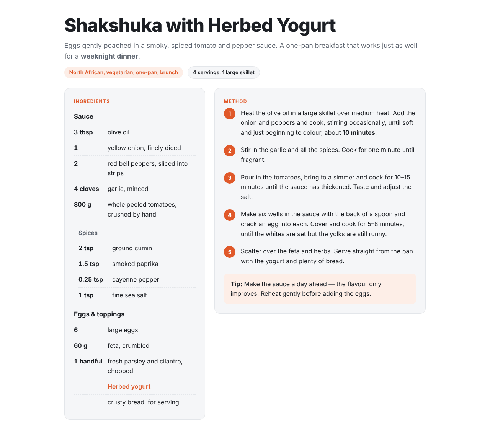 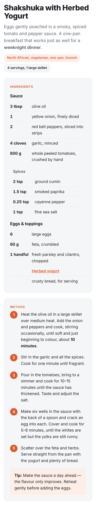

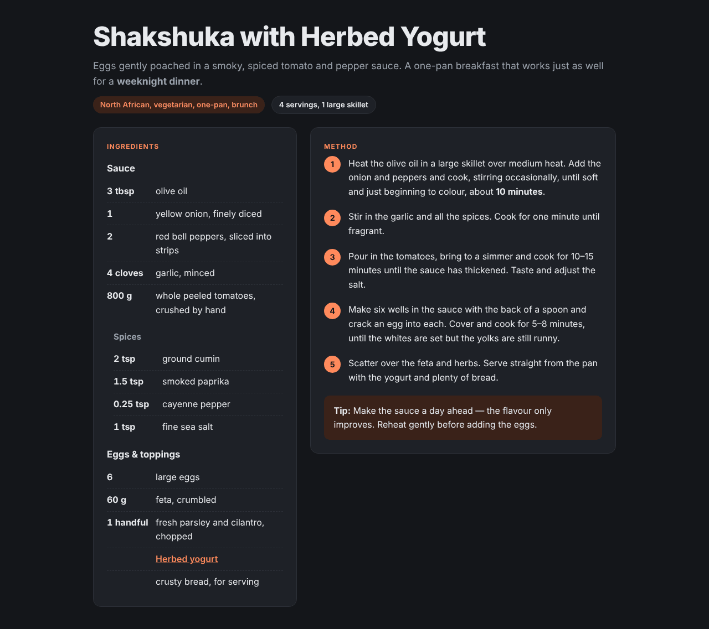 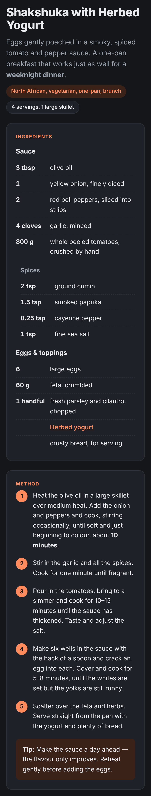

### 05 — Complete

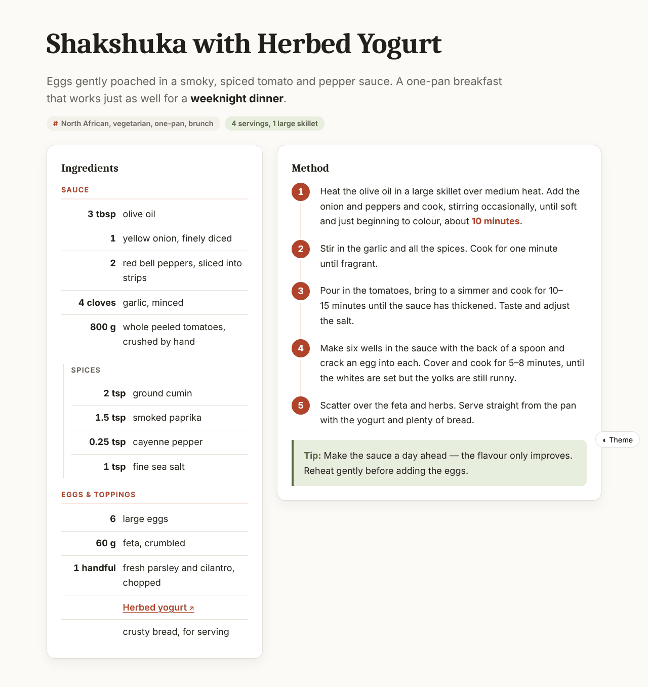 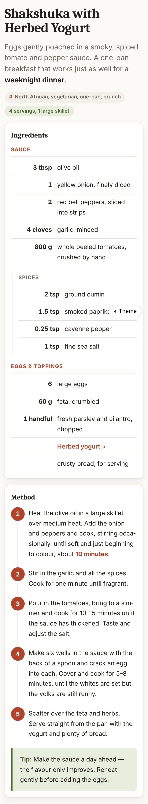

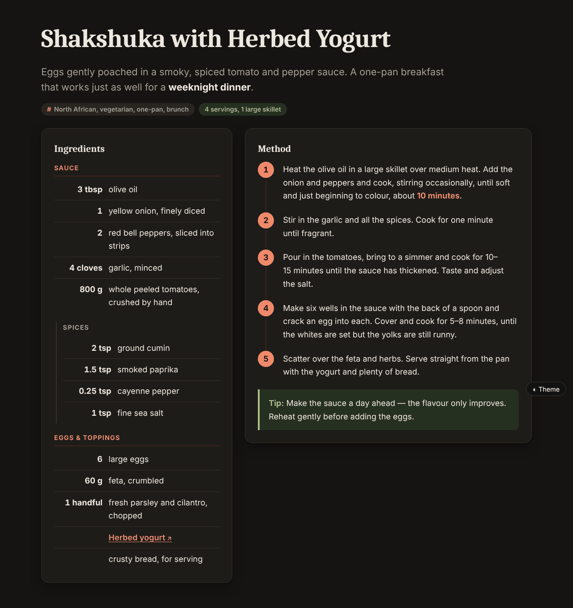 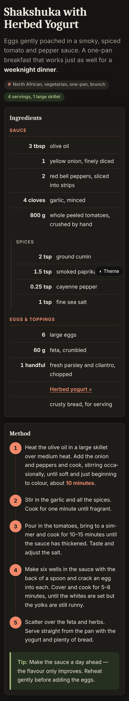

Print:

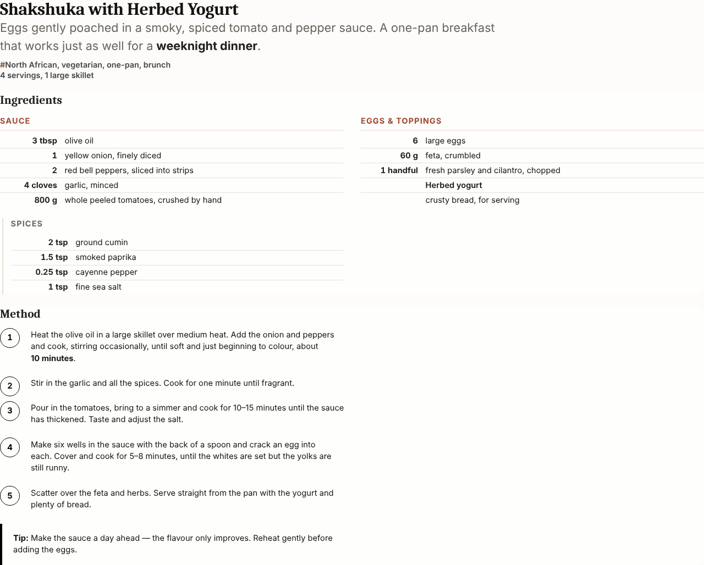
